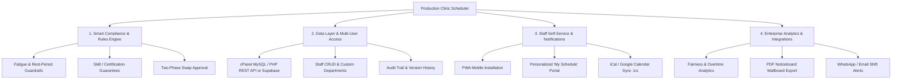
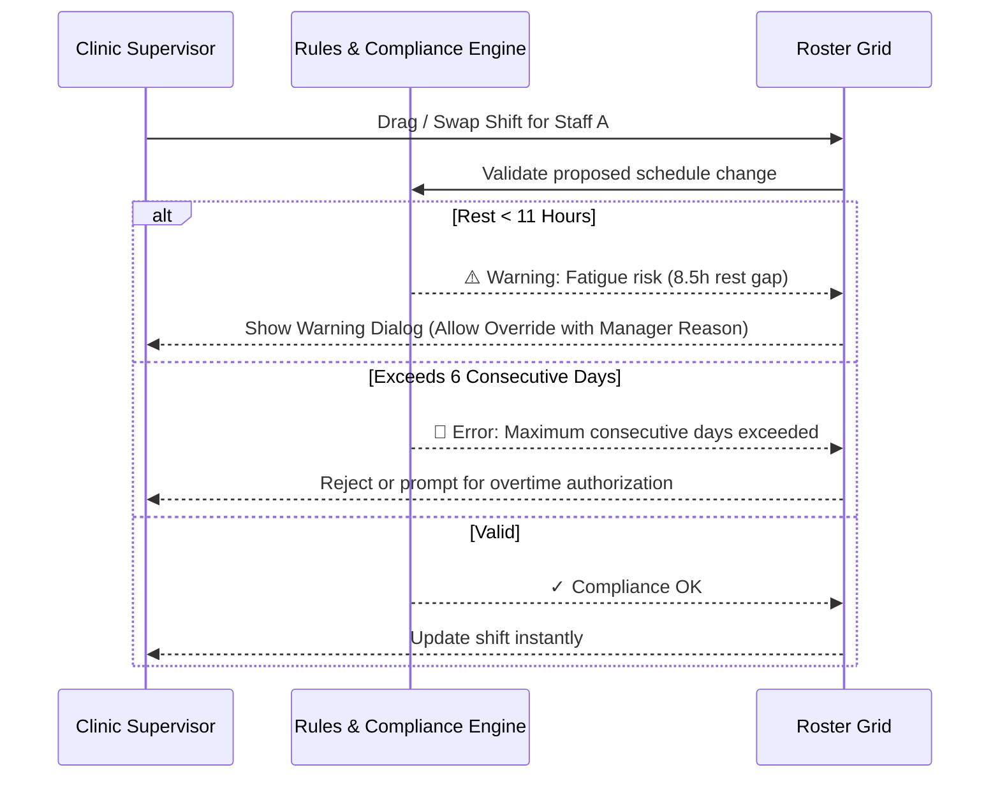
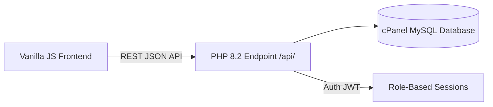
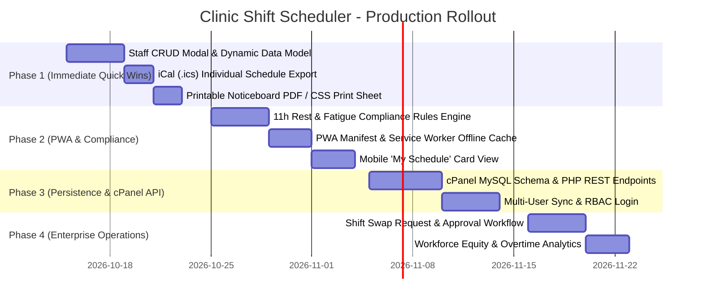

# Production-Grade Implementation Plan: Clinic Shift Scheduler
**Platform Target:** `apollo.surajkhanna.com`  
**Current Baseline:** Vanilla HTML5 / CSS3 / ES6 + SheetJS + cPanel Automated Git Deployment  
**Document Version:** 1.0 (Production Roadmap)

---

## 1. Executive Summary & Vision

The **Clinic Employee Shift Scheduler** has a solid front-end foundation with multi-view scheduling (By Department, Week Timeline, Day View, Month View), interactive shift swapping, and high-fidelity multi-sheet `.xlsx` workbook generation.

To evolve from a client-side prototype into an **enterprise-ready workforce management platform**, we can introduce production-level features structured across four key pillars:

---

## 2. Feature Roadmap & Prioritization Matrix

| Phase | Feature | Business Value | Dev Effort | Target Impact |
|---|---|---|---|---|
| **Phase 1** | **Staff Management Portal (CRUD)** | High | Medium | Allows clinic managers to add/remove/edit employees, target hours, and contract types dynamically instead of hardcoding. |
| **Phase 1** | **iCal / Google Calendar (.ics) Export** | High | Low | Empowers employees to sync their assigned shifts straight to their phone calendars. |
| **Phase 1** | **Print-Ready PDF Wallboard** | Medium | Low | High-contrast physical noticeboard printouts for clinic breakrooms. |
| **Phase 2** | **Intelligent Compliance & Fatigue Engine** | Critical | Medium | Prevents illegal scheduling: enforeces 11h rest between shifts, max consecutive days, and fair night shift rotation. |
| **Phase 2** | **PWA (Progressive Web App) + Offline Sync** | High | Medium | Installable on mobile devices with Service Worker cache and local IndexedDB state. |
| **Phase 3** | **Persistent Database & REST API (cPanel Native)** | High | Medium | Replaces localStorage with MySQL/PHP on `apollo.surajkhanna.com` so multiple supervisors can collaborate. |
| **Phase 3** | **Role-Based Access Control (RBAC)** | High | Medium | Admin (full edit/publish), Supervisor (departmental review), Staff (read-only + swap requests). |
| **Phase 4** | **Shift Swap Request & Approval Workflow** | Medium | Medium | Staff proposes swap & colleague accepts → Supervisor reviews with 1 click. |
| **Phase 4** | **Workforce Analytics & Equity Metrics** | Medium | Low | Visual graphs measuring overtime, weekend balance, and night shift burden across staff. |

---

## 3. Detailed Specifications for New Features

### 3.1. Staff & Department Dynamic Management (Admin CRUD)
*Currently, the 12 staff members and 4 departments are hardcoded in `logic.js`.*

- **Dynamic Staff Roster Modal**:
  - Add new staff members with:
    - Full Name, Employee ID, Contact (Phone/Email).
    - Primary Department (`Reception`, `OPD`, `Call Center`, `Appointment Desk`, or custom).
    - Qualifications / Tags (`Senior`, `CPR Certified`, `Night Capable`, `Trainee`).
    - Contracted Weekly Hours (e.g. 40h standard, 20h part-time).
    - Default Preferred Rest Day.
  - Ability to deactivate/archive former employees without breaking historical schedule records.
- **Custom Department Creator**:
  - Enable clinics to add new clinics or departments (e.g., `Emergency Triage`, `Radiology`, `Pharmacy`, `Pediatrics`) with custom color tokens and floor tags.

---

### 3.2. Intelligent Compliance & Healthcare Rule Engine
*Hospital staffing requires strict compliance with labor regulations and medical safety.*

- **Rest-Period Guardrails (11-Hour Minimum Rest)**:
  - Detects "clopening" violations (e.g., staff working **2 PM Shift (finishes 10:30 PM)** followed by **7 AM Shift (starts 7:00 AM)** next morning = only 8.5 hours rest).
  - Displays a warning badge `⚠️ Short Rest Violation: 8.5h (< 11h required)` directly on the shift cell.
- **Maximum Consecutive Working Days**:
  - Automatically flags when any employee is scheduled for more than **6 consecutive days** without a rest day.
- **Night Shift Rest Recovery Rule**:
  - After completing a 12-hour Overnight Shift (`8:00 PM - 8:00 AM`), mandates a minimum **24-hour rest recovery** before the next scheduled shift.
- **Minimum Station Coverage Thresholds**:
  - Alert banner if Reception dips below 1 staff at any hour, or if Call Center has fewer than 2 agents during peak hours (10:00 AM - 2:00 PM).

---

### 3.3. Personal Calendar Sync (iCalendar / `.ics` Feed)
*Employees want their shifts on their personal smartphones without logging in daily.*

- **One-Click `.ics` Export**:
  - Filter by individual employee: **"Download My Shifts (.ics)"**.
  - Adds real calendar events to Apple Calendar, Google Calendar, or Microsoft Outlook:
    - **Event Title**: `🏥 Clinic Shift - Reception [7 AM]`
    - **Start / End Times**: Exact timestamps with local time zone (`Asia/Kolkata` / `America/New_York`).
    - **Location**: `Ground Floor (GF), Apollo Clinic`.
    - **Description**: Station responsibilities, peer staff on duty.
    - **Notification Alert**: 1 hour before shift start.
- **Subscribe via Live WebCal URL (Optional Phase 3)**:
  - `webcal://apollo.surajkhanna.com/api/calendar.php?emp=Roshan&token=xyz`

---

### 3.4. Progressive Web App (PWA) & Mobile Quick-Punch
*Staff and supervisors frequently check the roster on their mobile phones.*

- **PWA Manifest (`manifest.json`)**:
  - Clinic app icon, theme color (`#8B3A22`), standalone display mode.
  - Install banner: "Add Clinic Scheduler to Home Screen".
- **Service Worker (`sw.js`)**:
  - Offline cache for all assets (`index.html`, `styles.css`, `logic.js`, `xlsx.full.min.js`, icons).
  - Works seamlessly during intermittent hospital Wi-Fi disconnects.
- **Dedicated "My Shifts" Mobile Quick View**:
  - Clean card deck showing:
    - **Today's Status**: "On Duty in 2h 15m" or "Rest Day".
    - **This Week's Schedule**: 7-day compact swipeable cards.
    - **Request Shift Swap Button**: Propose swap to a colleague.

---

### 3.5. Shift Swap Request & Approval Workflow
*Replaces uncoordinated direct edits with structured auditability.*

1. **Staff Initiates**: Employee selects their upcoming shift and chooses an eligible department peer with compatible rest.
2. **Peer Acknowledges**: Target colleague receives a pending badge: *"Roshan requested to swap Jul 8 (7 AM) with your Jul 9 (2 PM)"*.
3. **Supervisor Approves**: Manager clicks **"Approve Swap"** from the admin notification drawer. Roster updates automatically with a timestamped log entry.

---

### 3.6. Persistent Backend & Multi-User Architecture (cPanel Optimized)
*Currently, roster changes exist in `localStorage` on a single machine.*

Because the app is deployed via cPanel (`.cpanel.yml` to `/home/surajkh1/apollo.surajkhanna.com/`), we can leverage cPanel's built-in **PHP 8.x + MySQL** stack without adding costly cloud infrastructure:

- **Database Tables**:
  - `clinics` (id, name, timezone, settings)
  - `departments` (id, clinic_id, name, floor, target_headcount)
  - `staff` (id, dept_id, name, email, phone, role, contract_hours)
  - `shifts_config` (id, code, start_time, end_time, duration, color)
  - `roster_assignments` (id, staff_id, date, shift_id, notes, updated_by, updated_at)
  - `swap_requests` (id, requester_id, recipient_id, date_a, date_b, status)
  - `audit_log` (id, user, action, old_val, new_val, timestamp)

- **Lightweight Zero-Maintenance Alternative**:
  - Alternatively, if the user prefers zero backend code, **Supabase** or **Firebase Firestore** can be connected directly via JavaScript SDK with anonymous or email auth.

---

### 3.7. Workforce Analytics & Fairness Dashboard
*Prevents employee burnout and maintains fair rotation.*

- **Fairness Index Metrics**:
  - **Weekend Distribution**: Counts Saturday/Sunday shifts per staff member over a 4-week window to ensure fair rotation.
  - **Night Shift Frequency**: Monitors 12h night shifts (Karan currently works 6 night shifts/week; allows rotating night duties).
  - **Hours Variance**: Compares actual scheduled hours against contracted hours (e.g. 40h standard) to flag overtime or undertime.
- **Interactive Visual Cards**:
  - Clean progress bars and donut charts integrated into a collapsible **"Operations Metrics"** drawer.

---

## 4. Suggested Implementation Stages

---

## 5. Next Recommended Step

We can begin with **Phase 1 (Immediate High-Value Front-End Features)** right away:
1. **Dynamic Staff Roster Management**: Create a sleek slide-out drawer or modal where managers can add/edit staff names, phone numbers, and departments without touching code.
2. **Personal `.ics` Calendar Export**: Allow any staff member or manager to download their personal weekly schedule into Google Calendar / Apple Calendar.
3. **Print-Optimized Wallboard View**: Add a `@media print` layout so pressing `Ctrl+P` formats a clean, high-contrast, banner-ready schedule for clinic bulletin boards.
